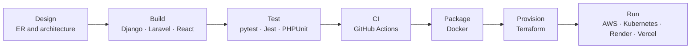

<div align="center">



<a href="https://git.io/typing-svg">
  
</a>

<br/>

<a href="https://maghandas.github.io/"></a>
<a href="https://linkedin.com/in/maghan-das"></a>
<a href="mailto:dasmaghan23@gmail.com"></a>


</div>

<br/>

## 🛰️ Mission control

```ts
const maghan = {
  location: "Budapest, Hungary 🇭🇺",
  education: "B.Sc. Computer Science @ ELTE  (GPA 4.82 / 5.00)",
  work: "Lab Assistant @ BME, mentoring 100+ students in debugging and system-level problem solving",
  focus: ["scalable web architecture", "microservices", "containers", "infrastructure as code"],
  cloud: ["AWS: EC2, VPC, RDS, S3, IAM", "Terraform", "Docker", "Kubernetes", "CI/CD"],
  currentlyPreparing: "Azure AZ-104",
  openTo: "Internships and junior roles in full-stack and cloud/DevOps",
};
```

<br/>

## 🚀 Featured projects

<table>
  <tr>
    <td width="50%" valign="top">
      <h3>📦 <a href="https://github.com/MaghanDas/manuflow">ManuFlow</a></h3>
      <sub>Manufacturing order tracker with live status updates</sub>
      <ul>
        <li>Three services: Django REST API, Node + Socket.io notifications, React + Redux SPA</li>
        <li>Role-based workflows and an enforced order state machine with audit log</li>
        <li>30+ automated tests, GitHub Actions CI, Kubernetes and Terraform (AWS) deployment</li>
      </ul>
      
      
      
      
      
    </td>
    <td width="50%" valign="top">
      <h3>⚡ <a href="https://github.com/MaghanDas/code-arena-api">CodeArena</a> · <a href="https://github.com/MaghanDas/code-arena-client">client</a></h3>
      <sub>Competitive coding platform with an automated judge</sub>
      <ul>
        <li>28 REST endpoints, Sanctum token auth and policy-based RBAC</li>
        <li>Judge runs JavaScript, Python and PHP against hidden test cases</li>
        <li>Timed contests with join flow and ranked leaderboards</li>
      </ul>
      
      
      
      
    </td>
  </tr>
  <tr>
    <td width="50%" valign="top">
      <h3>☁️ <a href="https://github.com/MaghanDas/Cloud-Native-FastApi">Cloud-Native Inventory</a></h3>
      <sub>Inventory app provisioned entirely as code on AWS</sub>
      <ul>
        <li>Terraform for EC2, VPC and RDS</li>
        <li>Zero-downtime GitHub Actions CI/CD</li>
        <li>FastAPI backend, React frontend, PostgreSQL</li>
      </ul>
      
      
      
      
    </td>
    <td width="50%" valign="top">
      <h3>🤝 <a href="https://github.com/MaghanDas/skillswap">SkillSwap</a></h3>
      <sub>Peer-to-peer skill exchange marketplace</sub>
      <ul>
        <li>Teachers host sessions, students book them, completed sessions get reviewed</li>
        <li>Student, teacher and admin dashboards with role-based access</li>
        <li>Responsive Tailwind UI, image uploads, Laravel Breeze auth</li>
      </ul>
      
      
      
    </td>
  </tr>
</table>

<br/>

## 🧭 How I ship

Every project follows the same path from first commit to running in the cloud.



<br/>

## 🪐 Tech universe

<div align="center">
  
  <br/><br/>
  
</div>

<br/>

## 📊 Flight log

<div align="center">
  
  
  <br/>
  
  <br/>
  
</div>

<br/>

## 👾 Contribution arcade

<div align="center">
  <picture>
    <source media="(prefers-color-scheme: dark)" srcset="https://raw.githubusercontent.com/MaghanDas/MaghanDas/output/pacman-contribution-graph-dark.svg" />
    
  </picture>
</div>

<br/>

<div align="center">
  
</div>
